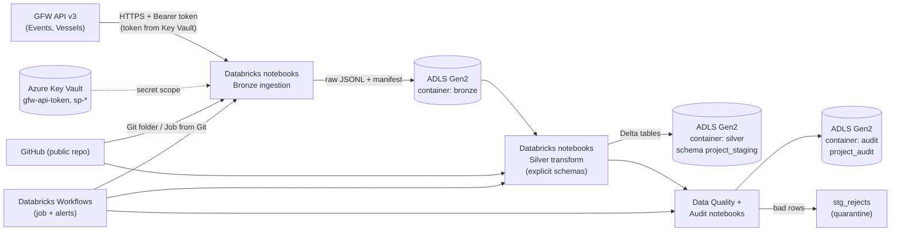

# Global Maritime Traffic & Vessel Activity Intelligence Warehouse
### Phase 2 – Azure Implementation (API → Bronze → Silver)

**Course:** DL3004 Data Warehousing & Business Intelligence Lab – Final Project
**Domain:** Global Maritime Intelligence · **Source:** Global Fishing Watch (GFW) API v3

| Member | Roll No | Role | Branch |
|---|---|---|---|
| Member 1 – ______________ | | Azure Infrastructure, Repository, Shared Code, `stg_ais_gaps` | `member1/azure-infra` |
| Member 2 – ______________ | | API Integration & Bronze Layer, `stg_vessels` | `member2/bronze-ingestion` |
| Member 3 – ______________ | | Silver Layer & Transformations | `member3/silver-transform` |
| Member 4 – ______________ | | Data Quality, Audit, Orchestration, Testing | `member4/dq-orchestration` |

> Team (from the proposal): Ibrahim Qaiser (24L-2513), Hafiza Syeda Urwa (24L-2561), Kinza Syed (24L-2427), Syeda Faryal Zehra (24L-2556). Decide together who is Member 1–4 and write the names above.

> **Roadmap:** the chronological plan is in [`ROADMAP.md`](ROADMAP.md).

---

## Table of Contents
1. [Project Overview](#1-project-overview)
2. [Project Objectives](#2-project-objectives)
3. [Official Phase 2 Requirements and How We Map Them](#3-official-phase-2-requirements-and-how-we-map-them)
4. [Implementation Scope – Silver Boundary](#4-implementation-scope--silver-boundary)
5. [Technology Stack](#5-technology-stack)
6. [Azure Architecture (API → Bronze → Silver)](#6-azure-architecture-api--bronze--silver)
7. [Azure Resource Setup (Step by Step)](#7-azure-resource-setup-step-by-step)
8. [GitHub and Azure Integration](#8-github-and-azure-integration)
9. [API and Data Source Overview](#9-api-and-data-source-overview)
10. [Bronze Implementation Plan](#10-bronze-implementation-plan)
11. [Silver Implementation Plan](#11-silver-implementation-plan)
12. [Four-Member Task Distribution](#12-four-member-task-distribution)
13. [Detailed Steps for Each Member](#13-detailed-steps-for-each-member)
14. [Repository Folder Structure](#14-repository-folder-structure)
15. [Git Branching and Collaboration Strategy](#15-git-branching-and-collaboration-strategy)
16. [Data Quality and Testing Strategy](#16-data-quality-and-testing-strategy)
17. [Security and Secrets Management](#17-security-and-secrets-management)
18. [Monitoring and Error Handling](#18-monitoring-and-error-handling)
19. [Azure Cost Management](#19-azure-cost-management)
20. [Integration Dependencies](#20-integration-dependencies)
21. [Final Deliverables Checklist](#21-final-deliverables-checklist)
22. [Appendix – Open Questions to Verify](#22-appendix--open-questions-to-verify)

---

## 1. Project Overview

Ships broadcast their position using AIS (Automatic Identification System). Raw AIS data is huge and hard to analyse. Our project builds a warehouse that turns **vessel events** into clean, analysis-ready data. The events come from the Global Fishing Watch API v3:

| Subject area | Events | Used for |
|---|---|---|
| Port logistics | Port visits | Dwell time, congestion, arrival patterns |
| Maritime security | AIS gaps ("dark fleet") | Intentional disabling, gap duration |
| Vessel operations | Fishing, loitering, encounters | Fishing effort, protected-area (MPA) events |
| Fleet intelligence | Vessel identity details | Length, tonnage, engine power, flag |

The full proposal designs a star schema (`Dim_Date`, `Dim_Vessel`, `Dim_Port`, `Dim_Location`, `Fact_Port_Visit`, `Fact_AIS_Gap`, `Fact_Vessel_Event`) and 10 business questions. **In this phase we only build the pipeline up to the Silver layer on Azure.**

## 2. Project Objectives

1. Extract GFW data securely and repeatably (initial load + incremental load).
2. Store the **raw** API responses in Azure Data Lake (**Bronze**).
3. Clean, type, de-duplicate and validate the data with **explicit schemas** (**Silver**).
4. Prove quality with data quality checks, audit logs and reports.
5. Keep all work in a **public GitHub repository** with **no secrets** inside.
6. Keep Azure cost within student credits.
7. Make Silver data ready for later modelling (dimensions/facts), without building them now.

## 3. Official Phase 2 Requirements and How We Map Them

The official Phase 2 PDF (DL3004, 40 marks) asks for the items below. The "Our plan" column shows how our Azure Silver-only scope responds. **Nothing is silently dropped.**

| # | Phase 2 requirement | Our plan | Status |
|---|---|---|---|
| 1 | **Data source** – public dataset or synthetic; ≥100 dimension records, ≥10,000 fact records | GFW API (public). Silver will hold 150k+ port visits (the script's target) plus gaps, events and vessels | ✅ Covered |
| 2 | **Architecture** Source → Staging → Warehouse → Reporting (PostgreSQL schemas `project_staging`, `project_dw`, `project_reporting`) | Source = API; **Bronze = raw landing**; **Silver = Phase 2 "staging"**. We name the Silver schema `project_staging` and the tables `stg_*` to match the PDF | 🟡 Staging only |
| 3 | **Staging layer**: remove duplicates, handle NULLs, standardize text, convert data types | Exactly the Silver tasks (Section 11) | ✅ Covered |
| 4 | **Dimensions with surrogate keys** (`customer_id C101 → customer_key 1001`) | Needs `Dim_*` tables with surrogate keys = **Gold layer** | ❌ Conflict with Silver-only scope |
| 5 | **Fact loading** with business-key → surrogate-key mapping | Needs dimensions first = **Gold layer** | ❌ Conflict |
| 6a | **DQ – Completeness** (missing values) | Silver DQ checks | ✅ Covered |
| 6b | **DQ – Accuracy** (PDF example: revenue reconciliation) | We have no revenue. We reconcile **Bronze unique IDs = Silver rows + rejects**, and sum of `duration_hours` Bronze vs Silver | ✅ Adapted |
| 6c | **DQ – Integrity** (fact rows without matching dimension = 0) | No facts/dimensions yet. We check **reference coverage** (e.g. event `vessel_id` exists in `stg_vessels`) | 🟡 Partial |
| 7 | Deliverable: PostgreSQL DB SQL scripts | Silver DDL as Spark SQL in `sql/` (Azure uses Spark/Delta, not PostgreSQL) | 🟡 Different engine |
| 8 | Deliverable: Staging Schema SQL | `sql/` Silver schema + table scripts | ✅ |
| 9 | Deliverable: DW Schema SQL | Gold-layer work | ❌ Out of scope |
| 10 | Deliverable: ETL scripts (SQL/Python) | Bronze + Silver notebooks and modules | ✅ |
| 11 | Deliverable: **Data Cleaning Report (PDF)** | Built from Silver audit counts | ✅ |
| 12 | Deliverable: Dimension Load Scripts / Fact Load Scripts | Gold-layer work | ❌ Out of scope |
| 13 | Deliverable: **Data Quality Report (PDF)** | Completeness + reconciliation + reference checks | 🟡 Partial |
| 14 | Deliverable: GitHub repository link | This repository | ✅ |

**Marks view (40):** ETL Pipeline (15) and most of Data Quality (10) are reachable. **Surrogate Key Implementation (5)**, most of **Database Implementation (10)** and the fact-related parts of ETL/DQ need the dimension, fact and DW/reporting layers, which are excluded by our current instruction.

> ⚠️ **Decision needed (Day 1, whole team):** ask the course instructor in writing whether a Silver-only submission is acceptable for Phase 2, and whether PostgreSQL is mandatory. If the answer is "no", we must add dimension/fact loading (and possibly Azure Database for PostgreSQL). That is a **separate plan**, and we will not start it unless you ask for it. Keep the reply in `docs/instructor_decision.md`.

## 4. Implementation Scope – Silver Boundary

**IN scope**
- **Bronze:** API extraction, secure token handling, initial + incremental load, pagination, retries, raw storage in Azure, ingestion timestamps and source metadata.
- **Silver:** explicit schemas, type conversion, de-duplication, NULL handling, text standardization, validation, load timestamps, audit info, clean storage.
- Data quality checks, audit logging, orchestration, tests, documentation, two PDF reports (cleaning + DQ).

**OUT of scope (do not build)**
- Gold layer (`Dim_*`, `Fact_*`, surrogate keys, `Dim_Date` generation), `project_dw`, `project_reporting`
- Power BI or any dashboard/analytics
- Phase 3 work

**Rule:** if a task makes you create a surrogate key, a dimension table or a fact table, **stop and ask the team**.

## 5. Technology Stack

| Need | Choice | Why (student friendly) |
|---|---|---|
| Cloud | Microsoft Azure | Required by team goal |
| Storage | **Azure Data Lake Storage Gen2** (Storage account with hierarchical namespace) | Cheap, folders, works with Spark |
| Spark compute | **Azure Databricks** (single-node, auto-terminate) | Easy notebooks, Delta Lake, Git integration, Jobs scheduler included |
| Secrets | **Azure Key Vault** + Databricks secret scope | Keeps tokens out of code and GitHub |
| Identity | **Microsoft Entra ID** app registration (service principal) | Lets Spark read/write storage safely |
| Orchestration | **Databricks Workflows (Jobs)** | No extra service to pay for |
| Code hosting | **GitHub** (public) + Databricks Git folders | Required by team goal |
| CI (optional) | GitHub Actions (lint, tests, secret scan) | Free for public repos |
| Languages | Python 3, PySpark, Spark SQL | |
| Table format | Delta Lake (Silver), JSON Lines (Bronze) | Delta gives MERGE for incremental loads |

**Services we deliberately do NOT use:** Azure Data Factory, Synapse, Event Hubs, Azure SQL / PostgreSQL, Power BI, Log Analytics. They add cost and are not needed up to Silver.

> ⚠️ **Day-1 check:** some student subscriptions limit regions, VM sizes or Databricks. Member 1 must confirm a Databricks workspace and a cluster can be created. Fallback: Microsoft Fabric trial (Lakehouse + Spark notebooks). Our code stays mostly the same, with only storage paths and secret access changing. Tell the team immediately if this happens.

## 6. Azure Architecture (API → Bronze → Silver)



**Storage containers (one storage account):**

| Container | Content |
|---|---|
| `bronze` | Raw API responses (unchanged JSON Lines), ingestion manifest, watermark state |
| `silver` | Delta tables of schema `project_staging`: `stg_port_visits`, `stg_ais_gaps`, `stg_vessel_events`, `stg_vessels`, `stg_rejects` |
| `audit` | Delta tables of schema `project_audit`: `pipeline_runs`, `dq_results` |

## 7. Azure Resource Setup (Step by Step)

**Owner: Member 1.** Do these in order. Use one name pattern. Replace `xx` with your team initials (storage account names must be **3–24 lowercase letters/numbers**, globally unique).

| Resource | Name |
|---|---|
| Resource group | `rg-maritime-dwbi` |
| Storage account | `stmaritimexx` |
| Key Vault | `kv-maritime-xx` |
| App registration | `sp-maritime-pipeline` |
| Databricks workspace | `dbw-maritime-xx` |
| Secret scope | `maritime-kv` |

### 7.1 Azure account
1. Go to <https://portal.azure.com> and sign in. Use **Azure for Students** if your university email qualifies. Otherwise use the Azure free account. *(Check current credit amounts on the Azure site. Do not assume.)*
2. **Home → Subscriptions →** open the subscription **→ Cost Management**. Note your remaining credit.
3. Give teammates access: open the **Resource group** (after 7.2) **→ Access control (IAM) → Add → Add role assignment →** role **Contributor →** Members: select teammates (invite as guests by email if they are not in your tenant). Do **not** give Owner.
4. Choose **one region** allowed by your subscription and use it for **every** resource (same region = lower cost and speed).

### 7.2 Resource group
Portal: **Resource groups → Create** → Subscription: your student subscription → Name: `rg-maritime-dwbi` → Region: your chosen region → **Review + create**.

### 7.3 Storage account (ADLS Gen2)
Portal: **Storage accounts → Create**

| Tab | Setting | Value |
|---|---|---|
| Basics | Resource group | `rg-maritime-dwbi` |
| Basics | Name | `stmaritimexx` |
| Basics | Region | same region |
| Basics | Performance | **Standard** |
| Basics | Redundancy | **LRS** (cheapest) |
| Advanced | **Enable hierarchical namespace** | ✅ **Checked** (this makes it Data Lake Gen2, and **cannot be changed later**) |
| Advanced | Allow enabling anonymous access on individual containers | **Disabled** |
| Advanced | Minimum TLS version | 1.2 |
| Advanced | Default access tier | Hot |
| Networking | Public network access | Enabled from all networks (simplest for students; we protect with identity) |

Then **Containers → + Container** and create three: `bronze`, `silver`, `audit` (Public access level: *Private*).

CLI alternative (Azure Cloud Shell, bash):
```bash
az group create -n rg-maritime-dwbi -l <region>
az storage account create -n stmaritimexx -g rg-maritime-dwbi -l <region> \
  --sku Standard_LRS --kind StorageV2 --enable-hierarchical-namespace true \
  --min-tls-version TLS1_2 --allow-blob-public-access false
for c in bronze silver audit; do
  az storage container create --account-name stmaritimexx --auth-mode login -n $c
done
```

### 7.4 Key Vault
Portal: **Key vaults → Create** → Name `kv-maritime-xx` → same region → Pricing tier **Standard** → Access configuration: **Azure role-based access control (RBAC)** → Review + create.
Then: **Key vault → Access control (IAM) → Add role assignment →** `Key Vault Secrets Officer` to Member 1 and Member 2 (they add secrets), and later `Key Vault Secrets User` to the Databricks service (see 7.7).

### 7.5 Service principal (identity used by Spark to reach storage)
1. Portal: **Microsoft Entra ID → App registrations → New registration** → Name `sp-maritime-pipeline` → Single tenant → **Register**.
2. On the overview page copy **Application (client) ID** and **Directory (tenant) ID**.
3. **Certificates & secrets → New client secret** → Description `databricks` → Expires **6 months** → copy the **Value** immediately (it is shown once).
4. **Storage account → Access control (IAM) → Add role assignment →** role **Storage Blob Data Contributor** → Assign access to *User, group, or service principal* → select `sp-maritime-pipeline`.
5. Also give **Storage Blob Data Contributor** to each teammate so they can view data in Storage Explorer.
6. In **Key Vault → Secrets → Generate/Import** create these secrets:

| Secret name | Value |
|---|---|
| `sp-client-id` | Application (client) ID |
| `sp-client-secret` | Client secret value |
| `sp-tenant-id` | Directory (tenant) ID |
| `gfw-api-token` | New GFW token (Member 2 provides, see Section 17) |

*Role assignments can take a few minutes to start working.*

### 7.6 Azure Databricks workspace
Portal: **Create a resource → Azure Databricks**
- Resource group `rg-maritime-dwbi`, Workspace name `dbw-maritime-xx`, same region.
- Pricing tier: **Premium** (needed for Key Vault-backed secret scopes and role-based access, so check the tier options shown for your subscription).
- Networking: defaults (no VNet injection, no secure cluster connectivity changes).
- **Review + create**, then **Launch Workspace**.

### 7.7 Key Vault-backed secret scope
1. Key Vault → **Properties**: copy **Vault URI** (DNS Name) and **Resource ID**.
2. Open `https://<your-databricks-workspace-url>#secrets/createScope`.
3. Scope Name: `maritime-kv` · Manage Principal: **All Users** · DNS Name: Vault URI · Resource ID: Resource ID → **Create**.
4. If notebooks cannot read secrets: Key Vault → IAM → assign `Key Vault Secrets User` to the **AzureDatabricks** application and retry.

### 7.8 Spark cluster (cheap settings)
Databricks → **Compute → Create compute**:

| Setting | Value |
|---|---|
| Policy | Personal Compute / Unrestricted (whatever lets you set the options below) |
| Mode | **Single node** |
| Runtime | Latest **LTS** (non-ML, non-GPU) |
| Photon | **Off** (saves cost) |
| Node type | Smallest general-purpose node available to your subscription (about 4 cores / 14–16 GB RAM, e.g. `Standard_DS3_v2` if available) |
| **Terminate after** | **15 minutes** of inactivity |
| Autoscaling | n/a (single node) |

**Advanced options → Spark config** (paste, replacing `stmaritimexx`):
```
fs.azure.account.auth.type.stmaritimexx.dfs.core.windows.net OAuth
fs.azure.account.oauth.provider.type.stmaritimexx.dfs.core.windows.net org.apache.hadoop.fs.azurebfs.oauth2.ClientCredsTokenProvider
fs.azure.account.oauth2.client.id.stmaritimexx.dfs.core.windows.net {{secrets/maritime-kv/sp-client-id}}
fs.azure.account.oauth2.client.secret.stmaritimexx.dfs.core.windows.net {{secrets/maritime-kv/sp-client-secret}}
fs.azure.account.oauth2.client.endpoint.stmaritimexx.dfs.core.windows.net https://login.microsoftonline.com/<TENANT_ID>/oauth2/token
```
The tenant ID is not a password, but it is cleaner to keep it as a secret reference (`{{secrets/maritime-kv/sp-tenant-id}}` inside the URL also works). Save the final config text (**with secret references only**) into `azure/spark_config.txt` in the repo.

Share the cluster: Compute → cluster → **Permissions →** give teammates **Can Attach To** (or **Can Restart**). Use **one shared cluster** during development to save money.

### 7.9 Connection test
Run `notebooks/00_setup_check.py` (created by Member 1). It must: read a secret (print only `len(secret)`, **never the value**), write a tiny file to `bronze`, read it back, and list the three containers. Expected paths look like:
```
abfss://bronze@stmaritimexx.dfs.core.windows.net/
abfss://silver@stmaritimexx.dfs.core.windows.net/
abfss://audit@stmaritimexx.dfs.core.windows.net/
```

### 7.10 Running the pipeline (Databricks Workflows)
1. **Workflows → Create job** `maritime_bronze_to_silver`.
2. Add tasks in order (details in Section 13, Member 4): `bronze_events` → `bronze_vessels` → `silver_*` → `dq_checks`.
3. Compute: **New job cluster**, single node, same node type (job compute is cheaper than interactive clusters).
4. Add **email notification on failure** to all four members.
5. Task source: **Git provider** (repo URL, branch `main`) so the job always runs the merged code.

---

## 8. GitHub and Azure Integration

### 8.1 Create the repository (Member 1)
1. GitHub → **New repository** → Name `maritime-dwbi` → **Public** → add README → `.gitignore` template **Python** → License **MIT** (optional).
2. **Settings → Collaborators →** invite the three teammates (Write access).
3. **Settings → Code security →** enable **Secret scanning** and **Push protection**.
4. **Settings → Branches → Add branch protection rule** for `main`: ✅ Require a pull request before merging · ✅ Require 1 approval · ✅ Require status checks (after CI exists) · ✅ Do not allow force pushes.
5. Create the folder skeleton (Section 14) in a first commit, then everyone clones.

```bash
git clone https://github.com/<team-or-user>/maritime-dwbi.git
cd maritime-dwbi
git config user.name  "Your Name"
git config user.email "your@email.com"
```

### 8.2 Connect GitHub to Databricks (each member)
1. GitHub → **Settings → Developer settings → Personal access tokens → Fine-grained tokens → Generate**: Repository access = *Only select repositories → maritime-dwbi*; Permissions: **Contents: Read and write**. Short expiry (e.g. 60 days).
2. Databricks → top-right user → **Settings → Linked accounts** (or **User Settings → Git integration**) → Provider **GitHub** → paste username + token → Save.
3. Databricks → **Workspace → Repos / Git folders → Add Git folder** → paste the repo HTTPS URL → Create.
4. Switch to your own branch inside the Git folder (branch dropdown), work, then **Commit & Push** (or use your laptop git).

> The token is stored inside **Databricks**, not in GitHub. Never paste it in code, README, or issues.

### 8.3 How code gets from GitHub to Azure
```
laptop / Databricks Git folder → push to your branch → Pull Request → review + CI → merge to main
→ Databricks Job (task source: Git, branch main) runs the merged notebooks on Azure
```
Optional CI (`.github/workflows/ci.yml`, Member 1): on every pull request run `flake8`, `pytest` (tests use small sample data, **no Azure access**), and a secret scan such as `gitleaks`. **No Azure secrets are needed in GitHub Actions** for this scope. If the team later wants GitHub to trigger Databricks, store only `DATABRICKS_HOST` and `DATABRICKS_TOKEN` in **GitHub → Settings → Secrets and variables → Actions**. Never in files. Keep the optional deploy step manual (`workflow_dispatch`).

### 8.4 Which secret goes where
| Where | Stores | Never stores |
|---|---|---|
| **Azure Key Vault** | GFW token, service principal ID/secret/tenant | – |
| **Databricks secret scope** | Pointer to Key Vault | Plain values |
| **GitHub Secrets** | Only CI/deploy tokens if used | GFW token (not needed in CI) |
| **Environment variables / `.env`** (local only, git-ignored) | Local testing values | – |
| **Repo files** | `*.template` files with fake placeholder values | Any real credential |

---

## 9. API and Data Source Overview

> **Source of truth:** the uploaded `marineapi.py` (our working extraction script). It is the only API information in our files. There is **no separate API documentation file**, so anything the script does not show is marked ⚠️ *verify*.

### 9.1 What the script confirms

| Item | What we know from the script |
|---|---|
| Base URL | `https://gateway.api.globalfishingwatch.org/v3` |
| Authentication | HTTP header `Authorization: Bearer <token>` + `Content-Type: application/json` |
| Token check | `GET /vessels/search` with `query`, `datasets[0]=public-global-vessel-identity:latest`, `limit` |
| Events endpoint | `POST /events` with query params `limit`, `offset` and a JSON body |
| Events body | `datasets`, `geometry` (GeoJSON Polygon), `startDate`, `endDate`, `types` |
| Events response | JSON with `entries` (list) and `nextOffset` (null/missing at the end) |
| Vessel details | `GET /vessels` with `datasets[0]=public-global-vessel-identity:latest` and `ids[0..19]` (**20 IDs per request**) |
| Vessel response | JSON with `entries`; each has `selfReportedInfo[]` and `combinedSourcesInfo[]` |
| Page size | `limit=1000`; script falls back to `100` if HTTP 400/422 |
| Retries | Script retries on HTTP 429, 500, 502, 503, 504 and on network errors, with growing waits |
| Rate limits | **Not documented in our files.** The script only reacts to HTTP 429. ⚠️ *verify* |

### 9.2 Entities (datasets)

| Entity | Dataset id used | Event `type` | Script scope |
|---|---|---|---|
| Port visits | `public-global-port-visits-events:latest` | `PORT_VISIT` | 13 port bounding boxes, month by month, **no cap** |
| AIS gaps | `public-global-gaps-events:latest` | `GAP` | Worldwide polygon, cap 15,000 per month |
| Fishing | `public-global-fishing-events:latest` | `FISHING` | Worldwide, cap 15,000 per month |
| Loitering | `public-global-loitering-events:latest` | `LOITERING` | Worldwide, cap 15,000 per month |
| Encounters | `public-global-encounters-events:latest` | `ENCOUNTER` | Worldwide, cap 15,000 per month |
| Vessels | `public-global-vessel-identity:latest` | – | Up to 8,000 vessel IDs found in the events |

The 13 port regions are Singapore, Rotterdam, Shanghai, LA/Long Beach, Jebel Ali, Karachi, Busan, Hong Kong, Antwerp, Hamburg, Port Klang, New York/NJ and Santos (bounding boxes are in the script; we will move them to `config/ports_regions.yaml`).

### 9.3 Fields the script reads (JSON path → meaning)

**Common to all events:** `id` (event id), `type`, `start`, `end`, `vessel.id`, `vessel.name`, `vessel.ssvid`, `vessel.flag`, `vessel.type`, `position.lat`, `position.lon`, `regions.eez`, `regions.highSeas`, `regions.mpa`, `regions.mpaNoTake`, `distances.*`

| Entity | Entity-specific fields |
|---|---|
| Port visit | `port_visit.visitId`, `port_visit.durationHrs`, `port_visit.confidence`, `port_visit.startAnchorage.name`, `port_visit.endAnchorage.{name, flag, lat, lon, atDock}`, `distances.{start,end}DistanceFromPortKm`, `distances.{start,end}DistanceFromShoreKm` |
| AIS gap | `gap.durationHours`, `gap.distanceKm`, `gap.impliedSpeedKnots`, `gap.intentionalDisabling`, `gap.offPosition.{lat,lon}`, `gap.onPosition.{lat,lon}`, `gap.positionsPerDaySatReception` |
| Fishing / Loitering / Encounter | `fishing.{averageSpeedKnots, totalDistanceKm, averageDurationHours, potentialRisk}`, `loitering.{averageSpeedKnots, totalDistanceKm, totalTimeHours}`, `encounter.{type, medianSpeedKnots, medianDistanceKilometers, potentialRisk, vessel.id, vessel.name}`, `distances.{startDistanceFromShoreKm, startDistanceFromPortKm}` |
| Vessel details | From `selfReportedInfo[0]`: `id`, `shipname`, `ssvid`, `imo`, `callsign`, `flag`. From `combinedSourcesInfo[0]`: `bestLengthM`, `bestTonnageGt`, `bestEnginePowerKw`, `maxSpeedKn`, `shiptypes`, `geartypes` (lists) |

### 9.4 Incremental loading – what we can and cannot claim
- **Supported (confirmed by the script):** the request body takes `startDate` and `endDate`, so we can request a **time window**. Our incremental strategy uses a **watermark window** (Section 10.3).
- ⚠️ **To verify with real responses** (Member 2, Phase 1): whether the window filters on event *start* or on any *overlap*; whether old events can change later (late updates); the latest date with data; maximum usable `offset`; documented rate limit/quota; whether `total` or other counters exist in the response.
- The API has **no "modified since" filter** in our files, so we will **not** claim "true CDC". We use "re-read a small overlap window + de-duplicate by `id` in Silver".

### 9.5 Known issues in the current script (must be fixed when we refactor)
1. **A real API token is hard-coded in `marineapi.py`.** Never commit this file. Treat the token as exposed and **replace it** (Section 17).
2. It writes **flat CSVs** (section 5 of the script). That is a **Silver** task. In Bronze we store the **raw JSON** and flatten in Silver with explicit schemas.
3. Expressions like `a or b` drop valid `0` values. Our Silver code must not copy that pattern.
4. List fields (e.g. `shiptypes`) are saved as JSON strings. Silver should parse them explicitly.
5. Port boxes can overlap, so the same visit may be downloaded twice → Silver de-duplicates by event `id`.
6. Vessel enrichment is capped at 8,000 vessels, while the proposal mentions ~88,000 vessels. Many event `vessel_id`s will have **no** vessel record. DQ must report this as **coverage**, not crash.

### 9.6 Business questions → Silver columns (what Silver must expose)

| Question topic | Required Silver columns |
|---|---|
| Port traffic, dwell, congestion, arrival hours | `stg_port_visits`: `end_anchorage_name`, `start_ts`, `duration_hrs` |
| Dwell by vessel type, flag distribution | `stg_port_visits`: `vessel_type`, `vessel_flag` |
| Fleet capacity (length, GT, kW) | `stg_vessels`: `length_m`, `tonnage_gt`, `engine_power_kw`, `ship_types` |
| Fishing by flag, MPA events, loitering | `stg_vessel_events`: `event_type`, `vessel_flag`, `duration_hours`, `mpa`, `mpa_no_take`, `start_dist_shore_km` |
| Dark fleet | `stg_ais_gaps`: `duration_hours`, `intentional_disabling`, `off_lat`, `off_lon`, `distance_km` |

---

## 10. Bronze Implementation Plan

**Principle:** Bronze keeps data **exactly as the API returned it**. We add metadata *around* it, not inside it.

### 10.1 Bronze layout (container `bronze`)
```
gfw/events/<event_type>/load_type=<initial|incremental>/ingest_date=YYYY-MM-DD/<region>_<YYYY-MM>.jsonl
gfw/vessels/load_type=<...>/ingest_date=YYYY-MM-DD/batch_0001.jsonl
_manifest/ingestion_manifest/        (one JSON record per extracted chunk)
_state/watermark.json                (last successfully loaded window per entity/region)
```
`event_type` ∈ `port_visit`, `gap`, `fishing`, `loitering`, `encounter`. `<region>` is the port name for port visits and `world` for the other events.

### 10.2 Metadata kept for every chunk (manifest record)
`run_id`, `entity`, `dataset`, `region`, `window_start`, `window_end`, `load_type`, `request_limit`, `rows_received`, `file_path`, `status` (`SUCCESS`/`FAILED`), `retry_count`, `error_message`, `started_at_utc`, `finished_at_utc`, `source_url`, `api_version` (`v3`).
This gives us **ingestion timestamps and source metadata** without changing the raw files. Silver adds the file path (`_source_file`) so every Silver row is traceable.

### 10.3 Initial vs incremental load
| | Initial load | Incremental load |
|---|---|---|
| Window | `START_MONTH` → month where targets are reached (script default: 2025-01, stops at 300 MB raw and 150k unique visits, limit 2025-12) | From `watermark − overlap_days` (default **7 days**, config) to the new end date |
| Trigger | `load_type=initial`, no watermark | `load_type=incremental`, watermark exists |
| After success | Write watermark = last fully loaded `window_end` | Advance watermark only if **all** chunks succeeded |
| Re-run safe? | Finished chunks are skipped (like the script's resume logic) | Overlap duplicates are removed in Silver by `id` |

> ⚠️ **Planning note:** our data covers 2025 only. If the initial load already reaches December, there is no "new" data left. Decide in Phase 1: **initial = first N months, incremental = later months**. Keep at least the last 1–2 months for the incremental demo. Show two runs in the demo: the second run must add only the new window and create **zero duplicates** in Silver.

### 10.4 Pagination, rate limits, failures
- Loop `offset`/`nextOffset` with `limit=1000` until `entries` is empty or `nextOffset` is missing (as in the script). Fall back to `limit=100` on HTTP 400/422.
- Retry HTTP 429/5xx and network errors with exponential back-off (max 6 tries). Respect a `Retry-After` header **if** present ⚠️ *verify*.
- Write to a `.part` file, then **rename** only if the chunk finished. A failed chunk leaves no half file and is logged as `FAILED` in the manifest.
- Keep concurrency low (script uses 5 workers) and make it a config value.
- Never log the token.
- Write a 4xx (not 400/422/429) as a hard failure: stop that chunk and log the response text (first 200 chars).

### 10.5 Vessel enrichment
Vessel IDs come from the **already stored** event files (`vessel.id`), de-duplicated, then looked up 20 per request. This makes `bronze_vessels` **depend on** `bronze_events`. Keep the cap (`MAX_ENRICH_VESSELS`) in config.

---

## 11. Silver Implementation Plan

Silver schema name: **`project_staging`** (matches the Phase 2 PDF). Format: **Delta**. Audit schema: `project_audit`.

### 11.1 Silver tables

| Table | Source (Bronze) | Row key | Notes |
|---|---|---|---|
| `stg_port_visits` | `port_visit` events | `event_id` | Grain: one port visit by one vessel at one anchorage |
| `stg_ais_gaps` | `gap` events | `event_id` | Grain: one AIS gap for one vessel |
| `stg_vessel_events` | `fishing`, `loitering`, `encounter` events | `event_id` | Grain: one activity segment; `event_type` column |
| `stg_vessels` | vessel details | `vessel_id` | One row per vessel |
| `stg_rejects` | all | `reject_id` | Rows failing critical rules, with `reject_reason` and original JSON |

### 11.2 Explicit schemas (no `inferSchema`, no schema guessing)
Member 3 defines every schema as a `StructType` in `schemas/silver_schemas.py` and a matching Spark SQL `CREATE TABLE` in `sql/`. Two schemas exist per entity: **(a) Bronze read schema** (matching the raw JSON, mostly strings/doubles/nested structs) and **(b) Silver target schema** (final types). Types follow the team data dictionary:

| Silver column (examples) | Type |
|---|---|
| `event_id`, `vessel_id`, `visit_id`, `ssvid`, `imo` | `STRING` |
| `start_ts`, `end_ts` | `TIMESTAMP` (UTC) |
| `start_date` | `DATE` (derived from `start_ts`) |
| `duration_hrs`, `duration_hours`, `distance_km`, `*_dist_*_km`, `implied_speed_knots`, `avg_speed_knots`, `total_distance_km` | `DECIMAL(10,2)` |
| `lat`, `lon`, `off_lat`, `off_lon`, `end_anchorage_lat/lon` | `DECIMAL(10,6)` |
| `length_m`, `tonnage_gt`, `engine_power_kw`, `max_speed_kn` | `DECIMAL(10,2)` |
| `end_at_dock`, `intentional_disabling`, `high_seas`, `mpa_no_take` | `BOOLEAN` |
| `ship_types`, `gear_types` | `ARRAY<STRING>` (parsed from JSON list) |
| Audit columns | `_source_file STRING`, `_bronze_ingest_ts TIMESTAMP`, `_silver_load_ts TIMESTAMP`, `_run_id STRING` |

Team to confirm exact column lists for each table in `docs/silver_data_dictionary.md` (Member 3 owns it). Column names come from the script's flat-file headers (e.g. `event_id, vessel_id, vessel_name, ssvid, vessel_flag, vessel_type, start, end, duration_hrs, ...`) but use clearer names (`start_ts`, `end_ts`).

### 11.3 Transformations (apply in this order)
1. **Read Bronze** JSON Lines using the explicit Bronze read schema. Add `_source_file` using the file path metadata column.
2. **Flatten** nested JSON paths to columns (9.3 lists the paths). Do not use `a or b` fallbacks that lose zeros.
3. **Convert types** using the table above. Unparseable values become `NULL` and are counted in the audit (not dropped silently).
4. **Standardize text:** trim, collapse repeated spaces, empty string → `NULL`. `flag`, `event_type`, `vessel_type`, `encounter_type` → **UPPER**. Port/anchorage/vessel names → trim + consistent case (e.g. `" lahore "` and `"LAHORE"` → `Lahore`, as in the Phase 2 PDF). ⚠️ *Look at real Bronze values first and write the final casing rule in `docs/silver_data_dictionary.md`.*
5. **Handle NULLs** (document each rule):
   - Critical (`event_id`, `vessel_id` for event tables, `start_ts`, duration) missing → row goes to `stg_rejects`.
   - `vessel_name` missing → `'Unknown'` (per team data dictionary).
   - Boolean flags missing → `FALSE` (per team DDL defaults) and counted in audit.
   - Measures (speed, distance, length, tonnage, power) missing → stay `NULL`. **Never replace with 0.**
6. **De-duplicate:** by `event_id` (or `vessel_id`). If duplicates exist keep the row with the latest `_bronze_ingest_ts`. Record how many duplicates were removed.
7. **Validate** (rules in Section 16). Failing critical rules → `stg_rejects`; soft failures → kept and logged as warnings.
8. **Add audit columns** (`_silver_load_ts`, `_run_id`, `_bronze_ingest_ts`, `_source_file`).
9. **Write Delta**: first run creates the table; later runs use **MERGE on the key** so re-runs and incremental loads never create duplicates.

### 11.4 Silver must not contain
Surrogate keys, `Dim_*`/`Fact_*` tables, aggregations, or reporting views.

---

## 12. Four-Member Task Distribution

| | **Member 1** | **Member 2** | **Member 3** | **Member 4** |
|---|---|---|---|---|
| **Main job** | Azure + repo + shared code | API + Bronze | Silver transformations | Data quality + audit + orchestration + testing |
| **Branch** | `member1/azure-infra` | `member2/bronze-ingestion` | `member3/silver-transform` | `member4/dq-orchestration` |
| **Silver table** | `stg_ais_gaps` (after infra is done) | `stg_vessels` (after Bronze is done) | `stg_port_visits`, `stg_vessel_events` + shared transform helpers | – (validates all) |
| **Report** | Data Cleaning Report (PDF) | API notes + Bronze load report | Silver data dictionary | Data Quality Report (PDF) |
| **Azure services** | Portal, Storage, Key Vault, Entra ID, Databricks setup, Cost Mgmt | Databricks, ADLS, Key Vault (read) | Databricks, ADLS | Databricks Workflows, ADLS audit |
| **Starts at once?** | Yes | Yes | Yes (with sample JSON) | Yes (with rule design) |

**Why this is balanced:** Member 1's setup is mostly short, so Member 1 later also builds `stg_ais_gaps` (the simplest, flattest table) and the cleaning report. Member 2's Bronze work is large but the script already exists, so Member 2 also does `stg_vessels`. Member 3 has the most transformation logic, so Member 3 does two tables plus the shared helpers, and nothing else. Member 4 owns quality, audit, orchestration and testing, which are all needed to prove the pipeline works.

---

## 13. Detailed Steps for Each Member

### 13.1 Member 1 – Azure Infrastructure, Repository and Shared Code
**Branch:** `member1/azure-infra`
**Where you work:** Azure Portal (Phase 0–1), GitHub (Phase 0), Databricks notebooks (Phase 1, 5)

**Tasks**
1. Create Azure subscription access, resource group, storage account, containers, Key Vault, service principal, Databricks workspace, secret scope, cluster (Section 7).
2. Give teammates the right roles (Section 7.1, 7.4, 7.5) and share the cluster.
3. Create the GitHub repository, branch protection, secret scanning, `.gitignore`, PR template, CI file (Section 8, 14).
4. Create the **shared code package** `common/`: `config.py` (reads `config/pipeline_config.yaml`), `paths.py` (builds `abfss://` paths from config), `secrets.py` (wrapper around `dbutils.secrets.get`, **never prints values**), `logging_utils.py`.
5. Create config templates: `config/pipeline_config.template.yaml`, `config/ports_regions.yaml`, `.env.template`.
6. Write `notebooks/00_setup_check.py` and `sql/00_create_schemas.sql` (`CREATE SCHEMA project_staging`, `project_audit` with locations in `silver` and `audit`).
7. Set up the Azure budget alerts (Section 19) and write `docs/azure_setup.md` with screenshots (blur IDs/URLs if you like).
8. Write `docs/phase2_requirements_mapping.md` (copy Section 3 and keep it up to date) and `docs/instructor_decision.md`.
9. **Later (Phase 5):** build `silver/stg_ais_gaps.py` using Member 3's template and helpers.
10. **Later (Phase 7):** assemble the **Data Cleaning Report (PDF)** from Silver audit numbers (before/after counts, duplicates removed, NULLs handled, text fixed, rejects).

**Files to create:** `azure/spark_config.txt`, `azure/cluster_settings.md`, `azure/cost_budget.md`, `common/*.py`, `config/*`, `.github/workflows/ci.yml`, `.github/pull_request_template.md`, `requirements.txt`, `requirements-dev.txt`, `notebooks/00_setup_check.py`, `sql/00_create_schemas.sql`, `docs/azure_setup.md`, `docs/phase2_requirements_mapping.md`, `silver/stg_ais_gaps.py`, `reports/data_cleaning_report.pdf`

**Expected deliverables:** working Azure environment; everyone can clone, run `00_setup_check`, and read/write the three containers; protected `main`; CI passing.
**Depends on:** nobody to start. Others depend on you for access (Day 1–3).
**Testing:** every teammate runs `00_setup_check` successfully; a test PR is blocked until reviewed; `git log` and a secret scan show no secrets; cost alert email received (test).
**Commit to repo:** everything under "Files to create". **Never commit:** secrets, `.env`, screenshots showing secret values.

**Checklist – Member 1**
- [ ] Azure subscription ready; region chosen; Databricks creation confirmed possible
- [ ] Resource group, storage (HNS on), 3 containers created
- [ ] Key Vault created; 4 secrets present (`sp-client-id`, `sp-client-secret`, `sp-tenant-id`, `gfw-api-token`)
- [ ] Service principal + Storage Blob Data Contributor role assigned
- [ ] Databricks workspace + Key Vault-backed secret scope `maritime-kv`
- [ ] Cluster with Spark config and 15-min auto-terminate; shared with team
- [ ] Budget alerts at 50 / 80 / 100 %
- [ ] GitHub repo, collaborators, branch protection, secret scanning ON
- [ ] Folder skeleton, `.gitignore`, templates, PR template committed
- [ ] `common/` package + config templates committed
- [ ] `00_setup_check` passes for all 4 members
- [ ] CI workflow runs on PRs
- [ ] `stg_ais_gaps` notebook merged
- [ ] Data Cleaning Report PDF produced
- [ ] `docs/azure_setup.md` and requirement-mapping doc complete

---

### 13.2 Member 2 – API Integration and Bronze Layer
**Branch:** `member2/bronze-ingestion`
**Where you work:** Python/Databricks notebooks (and local Python for first API experiments), Key Vault (add the token)

**Tasks**
1. **API investigation (Phase 1, first 2 days):** with a **new** token, call each endpoint for a tiny window (one port, one day) and save sample responses. Write `docs/api_notes.md` answering every ⚠️ *verify* item in Sections 9.4 and 22. Save 1–2 small sample JSON files (anonymous, small) in `sample_data/` for teammates (**no token inside**).
2. **Token security (Day 1):** get a new token from the GFW application page, store it in Key Vault as `gfw-api-token`, and make sure the old token is revoked/regenerated (Section 17).
3. Refactor `marineapi.py` into modules (no hard-coded token):
   - `ingestion/gfw_client.py` – session, headers, retry/backoff, error classes
   - `ingestion/events_extractor.py` – paginated `POST /events` for one window
   - `ingestion/vessels_extractor.py` – batched `GET /vessels` (20 ids)
   - `ingestion/watermark.py` – read/write `_state/watermark.json`
   - `ingestion/manifest.py` – write one manifest record per chunk
4. Create Bronze notebooks: `bronze/10_bronze_events_initial.py`, `bronze/11_bronze_events_incremental.py`, `bronze/12_bronze_vessels.py`. Notebooks take widgets/parameters: `load_type`, `start_date`, `end_date`, `run_id`.
5. Write raw JSONL to the Bronze layout (Section 10.1) using `.part` → final rename.
6. Time one month for one port and estimate the whole initial load. Report the estimate to the team (cluster cost depends on it).
7. Run the initial load, then an incremental run; confirm the watermark advances only on full success.
8. **Later (Phase 5):** build `silver/stg_vessels.py` (parse `shiptypes`/`geartypes` lists, text standardization, `'Unknown'` names).
9. Write `docs/bronze_load_report.md`: files, MB, rows per entity, runtime, failures.

**Technologies:** Python `requests`, PySpark (for reading back), ADLS Gen2, Key Vault via secret scope, Databricks.
**Expected deliverables:** Bronze data in Azure for all 5 event types + vessels; manifest; watermark; API notes; sample files for teammates; `stg_vessels`.
**Depends on:** Member 1 for storage, secret scope and `common/` (Phase 1). Until then, test locally and write to a local folder. Members 3 and 4 depend on your **sample files (Day 3)** and **Bronze layout (Day 3)**.
**Testing:** (a) unit tests with mocked HTTP responses for pagination, retry on 429/500, `.part` handling (`tests/test_ingestion.py`); (b) re-run the same window → no duplicate files, manifest says skipped; (c) kill a run midway → no corrupt file, next run completes; (d) incremental run only requests the new window.
**Commit to repo:** `ingestion/`, `bronze/`, `tests/test_ingestion.py`, `docs/api_notes.md`, `docs/bronze_load_report.md`, `sample_data/`, `silver/stg_vessels.py`.

**Checklist – Member 2**
- [ ] Old token replaced; new token only in Key Vault
- [ ] `docs/api_notes.md` answers all ⚠️ items
- [ ] Sample JSON files shared with team
- [ ] Modules refactored; no token or hard-coded paths in code
- [ ] Pagination, retry/backoff, `.part` rename working
- [ ] Initial load completed (events + vessels)
- [ ] Manifest records for every chunk
- [ ] Watermark + incremental run tested
- [ ] Unit tests passing in CI
- [ ] Bronze load report written
- [ ] `stg_vessels` notebook merged

---

### 13.3 Member 3 – Silver Layer and Transformations
**Branch:** `member3/silver-transform`
**Where you work:** Databricks notebooks (PySpark + Spark SQL); GitHub for PRs

**Tasks**
1. **Day 1–3:** from Sections 9.3 and 11.2 and `marineapi.py`, draft the explicit Bronze read schemas and Silver target schemas. Use Member 2's sample JSON when it arrives and correct the schemas.
2. Write `schemas/silver_schemas.py` (StructType definitions) and `docs/silver_data_dictionary.md` (every column: type, nullable, rule, example).
3. Write `silver/transform_utils.py` – **shared helpers used by all Silver notebooks**: `clean_text()`, `to_timestamp_utc()`, `to_decimal()`, `to_bool()`, `parse_json_list()`, `add_audit_columns()`, `dedupe_latest()`, `split_valid_rejects()`. Publish this by **Day 8** so Members 1 and 2 can reuse it.
4. Write notebooks `silver/20_stg_port_visits.py` and `silver/21_stg_vessel_events.py` (the vessel events notebook handles fishing, loitering and encounter with the correct field paths per type).
5. Write the Spark SQL table scripts `sql/10_stg_tables.sql` for all five Silver tables (including `stg_rejects`).
6. Implement MERGE-based writes so reruns are idempotent.
7. Count and record: rows in, nulls fixed, duplicates removed, rejects, rows out (give counts to Member 4's audit logger and to Member 1 for the cleaning report).
8. Review PRs of Members 1 and 2 for Silver notebooks (and vice versa).

**Technologies:** PySpark, Delta Lake, Spark SQL, ADLS Gen2.
**Expected deliverables:** Silver Delta tables `stg_port_visits`, `stg_vessel_events` populated; schemas; helpers; data dictionary.
**Depends on:** Member 2 (Bronze files; start with samples), Member 1 (cluster, `common/`, schemas created), Member 4 (audit logger interface; use a simple stub until ready).
**Testing:** (`tests/test_transforms.py`) each helper with edge cases: `" lahore "`, `"LAHORE"`, empty string, `None`, invalid timestamp, negative duration, `0` speed (must stay `0`), duplicate ids. Row-count rule: **Bronze unique ids = Silver rows + rejects**. Re-run twice → same Silver count.
**Commit to repo:** `schemas/`, `silver/transform_utils.py`, `silver/20_*.py`, `silver/21_*.py`, `sql/10_stg_tables.sql`, `docs/silver_data_dictionary.md`, `tests/test_transforms.py`.

**Checklist – Member 3**
- [ ] Bronze + Silver schemas written (`schemas/silver_schemas.py`)
- [ ] No `inferSchema` anywhere (search the repo)
- [ ] Helper library merged by Day 8 and used by others
- [ ] `stg_port_visits` populated and idempotent
- [ ] `stg_vessel_events` populated (all 3 event types)
- [ ] NULL and text rules documented in the data dictionary
- [ ] `stg_rejects` receives bad rows with reasons
- [ ] Audit columns present on every row
- [ ] Unit tests passing
- [ ] Row counts handed to Members 1 and 4

---

### 13.4 Member 4 – Data Quality, Audit, Orchestration and Testing
**Branch:** `member4/dq-orchestration`
**Where you work:** Databricks notebooks, Databricks Workflows UI, GitHub Actions/pytest

**Tasks**
1. **Design the rules (Day 1–5):** write `data_quality/rules.yaml` from Section 16 (rule id, table, column, type, severity `CRITICAL`/`WARNING`, threshold).
2. Build `data_quality/dq_engine.py` – reads `rules.yaml`, runs each rule on a Silver table with Spark, returns pass/fail with counts. Build `data_quality/schema_validation.py` that compares the actual Delta schema with `schemas/silver_schemas.py`.
3. Build the **audit logger** `common/audit.py` (agree the interface with Member 3 on Day 5): `start_run()`, `end_run()`, `log_step(rows_in, rows_out, rejects, duplicates_removed)`, `log_dq_result()`. Tables: `project_audit.pipeline_runs`, `project_audit.dq_results`.
4. Write the DQ notebook `data_quality/30_dq_checks.py` and `sql/20_dq_checks.sql` (SQL versions of key checks).
5. **Orchestration:** create `orchestration/run_pipeline.py` (a simple driver notebook that passes `run_id`, `load_type`, dates) and `orchestration/workflow_job.json` (exported job definition, **no secrets**). Task order: `bronze_events → bronze_vessels → silver_port_visits | silver_vessel_events | silver_ais_gaps | silver_vessels → dq_checks`. Set retries (max 1–2) and email on failure.
6. **Integration testing (Phase 6):** run the full pipeline on a small sample, then the full data, then an incremental run, and the failure tests below. Log every bug as a GitHub Issue.
7. Write `docs/runbook.md`: how to run, rerun, and recover.
8. **Phase 7:** produce the **Data Quality Report (PDF)**: rules, results, failures, reconciliation, reference coverage, and the list of Gold-dependent checks that cannot run yet (Section 3).

**Technologies:** PySpark, Delta, YAML, `pytest`, Databricks Workflows, GitHub Actions.
**Expected deliverables:** DQ rules and engine; DQ results for all Silver tables; audit tables; working job; test evidence; runbook; DQ PDF.
**Depends on:** Member 3 (Silver tables and schemas, from Day ~10), Member 2 (Bronze counts), Member 1 (cluster, `common/`). You can write rules and the engine early with the sample data.
**Testing responsibility:** you own **integration testing** for the whole pipeline. See the scenarios below.
**Commit to repo:** `data_quality/`, `common/audit.py`, `sql/20_dq_checks.sql`, `orchestration/`, `tests/test_dq_engine.py`, `tests/integration_test_plan.md`, `docs/runbook.md`, `reports/data_quality_report.pdf`.

**Integration test scenarios**
| # | Scenario | Pass condition |
|---|---|---|
| 1 | Full run on sample (1 port, 1 month) | All tasks green; DQ no critical failures |
| 2 | Full initial load | Row counts reconcile (Bronze unique ids = Silver + rejects) |
| 3 | Re-run same window | Silver counts unchanged (idempotent) |
| 4 | Incremental run | Only new window added; zero duplicates |
| 5 | Wrong token (test secret) | Bronze fails cleanly; manifest `FAILED`; watermark unchanged |
| 6 | Corrupt/unknown field in a Bronze file | Row goes to rejects or schema check flags it; job does not silently continue |
| 7 | Rerun after mid-run failure | Pipeline resumes, no duplicates |

**Checklist – Member 4**
- [ ] `rules.yaml` complete (completeness, validity, uniqueness, integrity/reference, reconciliation)
- [ ] DQ engine and schema validation working
- [ ] Audit tables created; logger used by all notebooks
- [ ] DQ notebook produces results for all 4 Silver tables
- [ ] Workflow job created, retries and failure emails set
- [ ] `workflow_job.json` exported (no secrets)
- [ ] 7 integration scenarios executed and recorded
- [ ] GitHub Issues opened/closed for bugs
- [ ] Runbook written
- [ ] Data Quality Report PDF produced

---

## 14. Repository Folder Structure

```
maritime-dwbi/
├── README.md                      # this file
├── ROADMAP.md                     # chronological plan
├── requirements.txt               # runtime Python packages (requests, pyyaml, ...)
├── requirements-dev.txt           # pytest, flake8, pyspark (for local tests)
├── .gitignore                     # .env, *.csv, *.jsonl, gfw_final/, secrets, __pycache__
├── .env.template                  # fake placeholders only (local testing)
├── .github/
│   ├── workflows/ci.yml           # lint + tests + secret scan on pull requests
│   └── pull_request_template.md   # checklist for reviewers
├── azure/                         # Azure configuration (text only, no secrets)
│   ├── spark_config.txt           # Spark config with {{secrets/...}} references
│   ├── cluster_settings.md        # chosen cluster options
│   └── cost_budget.md             # budget numbers, alert levels
├── config/
│   ├── pipeline_config.template.yaml  # storage account, containers, overlap_days, page size, workers
│   └── ports_regions.yaml         # 13 port bounding boxes
├── common/                        # shared code used by every notebook
│   ├── config.py                  # load YAML config
│   ├── paths.py                   # build abfss:// paths
│   ├── secrets.py                 # read secrets safely
│   ├── logging_utils.py           # logger
│   └── audit.py                   # audit logger (Member 4)
├── ingestion/                     # API client code (Python modules)
│   ├── gfw_client.py
│   ├── events_extractor.py
│   ├── vessels_extractor.py
│   ├── watermark.py
│   └── manifest.py
├── bronze/                        # Bronze notebooks
│   ├── 10_bronze_events_initial.py
│   ├── 11_bronze_events_incremental.py
│   └── 12_bronze_vessels.py
├── silver/                        # Silver notebooks and helpers
│   ├── transform_utils.py
│   ├── 20_stg_port_visits.py
│   ├── 21_stg_vessel_events.py
│   ├── 22_stg_ais_gaps.py
│   └── 23_stg_vessels.py
├── schemas/
│   └── silver_schemas.py          # explicit StructType definitions (Bronze read + Silver target)
├── sql/
│   ├── 00_create_schemas.sql      # project_staging, project_audit
│   ├── 10_stg_tables.sql          # Silver table DDL
│   └── 20_dq_checks.sql           # SQL data quality checks
├── data_quality/
│   ├── rules.yaml                 # all rules
│   ├── dq_engine.py               # rule runner
│   ├── schema_validation.py       # actual vs expected schema
│   └── 30_dq_checks.py            # notebook that runs everything
├── orchestration/
│   ├── run_pipeline.py            # driver notebook
│   └── workflow_job.json          # exported Databricks job (no secrets)
├── notebooks/
│   └── 00_setup_check.py          # connection test
├── tests/
│   ├── test_ingestion.py          # Member 2
│   ├── test_transforms.py         # Member 3
│   ├── test_dq_engine.py          # Member 4
│   └── integration_test_plan.md   # Member 4
├── sample_data/                   # tiny sample JSON for tests (no secrets)
├── docs/
│   ├── azure_setup.md             # M1
│   ├── phase2_requirements_mapping.md  # M1
│   ├── instructor_decision.md     # M1
│   ├── api_notes.md               # M2
│   ├── bronze_load_report.md      # M2
│   ├── silver_data_dictionary.md  # M3
│   └── runbook.md                 # M4
└── reports/
    ├── data_cleaning_report.pdf   # M1 (final)
    └── data_quality_report.pdf    # M4 (final)
```
Notebooks are stored as `.py` files in "Databricks source format" (first line `# Databricks notebook source`) so they diff nicely in GitHub. **Do not commit** the original `marineapi.py`, raw data, or CSVs.

## 15. Git Branching and Collaboration Strategy

**Branches:** `main` (protected, always working) + one branch per member (Section 12). For big tasks make short sub-branches, e.g. `member2/bronze-incremental`. Nobody pushes directly to `main`.

### 15.1 Daily workflow (every member)
```bash
git checkout main
git pull origin main                      # get latest team work
git checkout member2/bronze-ingestion     # your branch (create it the first time: git checkout -b member2/bronze-ingestion)
git merge main                            # bring latest main into your branch (fix conflicts if any)

# ... do your work ...

git status                                # see what changed
git add ingestion/ bronze/ tests/         # add specific folders (avoid 'git add .' blindly)
git commit -m "feat(bronze): add paginated events extractor"
git push -u origin member2/bronze-ingestion   # first push; later just: git push
```

### 15.2 Commit message style
`type(scope): short message` – types: `feat`, `fix`, `docs`, `test`, `chore`. Examples: `fix(silver): keep 0 speed instead of NULL`, `docs(azure): add storage setup steps`. Commit small and often.

### 15.3 Pull request and code review
1. On GitHub open **Pull requests → New pull request**: base `main`, compare your branch.
2. Fill the PR template: what changed, how you tested, "no secrets committed ✅".
3. Assign **one reviewer** (review pairs: M1↔M4, M2↔M3). Reviewer checks: it runs, no secrets, no Gold-layer work, schemas explicit, tests included.
4. Fix comments by pushing more commits to the same branch.
5. When CI is green and approved → **Squash and merge** → delete the branch → everyone runs `git pull origin main`.
6. Merge conflicts: run `git merge main` in your branch, open the conflicted files, keep the right lines (remove `<<<<<<<`, `=======`, `>>>>>>>`), `git add`, `git commit`, push.

### 15.4 Rules
- **Never** commit: tokens, `.env`, `*.jsonl`, `*.csv`, Azure keys, screenshots with secrets.
- Each shared file has **one owner** (Section 14 comments). Others suggest changes by PR.
- If you accidentally commit a secret: **tell the team immediately, revoke the secret, then clean history.** Deleting the file in a new commit is **not** enough (Section 17).

## 16. Data Quality and Testing Strategy

### 16.1 DQ rules (Member 4 puts them in `rules.yaml`; severity C = critical → reject, W = warning → log)
| ID | Dimension | Rule | Tables | Sev |
|---|---|---|---|---|
| DQ-C01 | Completeness | `event_id` not NULL | events tables | C |
| DQ-C02 | Completeness | `vessel_id` not NULL | events tables, `stg_vessels` | C |
| DQ-C03 | Completeness | `start_ts` not NULL | events tables | C |
| DQ-C04 | Completeness | Null % of key measures (duration, length, tonnage, engine power) reported per column | all | W |
| DQ-U01 | Uniqueness | No duplicate `event_id` / `vessel_id` | all | C |
| DQ-V01 | Validity | `duration ≥ 0` and not absurd (threshold in config) | events tables | C |
| DQ-V02 | Validity | `end_ts ≥ start_ts` | events tables | C |
| DQ-V03 | Validity | lat in [-90, 90], lon in [-180, 180] | tables with coordinates | C |
| DQ-V04 | Validity | `event_type` ∈ {PORT_VISIT, GAP, FISHING, LOITERING, ENCOUNTER} | events tables | C |
| DQ-V05 | Validity | speeds, distances ≥ 0 | gaps, events | W |
| DQ-V06 | Validity | `imo` is 7 digits when present (per data dictionary) | `stg_vessels` | W |
| DQ-V07 | Validity | Dates inside expected load window | events tables | W |
| DQ-S01 | Schema | Delta schema = `silver_schemas.py` (names, types) | all | C |
| DQ-I01 | Reference | % of event `vessel_id` found in `stg_vessels` (coverage) | events tables | W (report %) |
| DQ-I02 | Reference | No NULL `end_anchorage_name` in port visits | `stg_port_visits` | W |
| DQ-R01 | Reconciliation | Bronze unique ids = Silver rows + rejects, per entity | all | C |
| DQ-R02 | Reconciliation | Sum of `duration` Bronze vs Silver (+ rejects) matches | all | W |
| DQ-A01 | Audit | Every Silver row has `_silver_load_ts` and `_run_id` | all | C |

Rules that need dimensions/facts (e.g. "fact rows without matching dimension = 0") are **listed in the DQ report as "not applicable until Gold"** — not skipped silently.

### 16.2 Testing levels
| Level | Who | What | Where |
|---|---|---|---|
| Unit | Each member | Pure Python/PySpark functions with small inputs | `tests/` (run by CI, no Azure) |
| Component | Owners | Bronze on 1 port × 1 month; Silver on sample Bronze | Databricks |
| Integration | Member 4 | Full job, incremental, failure scenarios (Section 13.4) | Databricks |
| Review | Pairs | PR review checklist | GitHub |

Run locally: `pip install -r requirements-dev.txt && pytest -q`.

## 17. Security and Secrets Management

> 🚨 **Urgent:** the uploaded `marineapi.py` contains a **real, long-lived GFW token written directly in the file**. If that file (or its git history) was ever shared or pushed anywhere public, treat the token as **compromised**. **Member 2, Day 1:** create a new token in the GFW API portal, remove/revoke the old one if possible, store the new one **only** in Key Vault (`gfw-api-token`), and never put it in a file again. We will not copy that file into the repository.

**Rules**
1. No credential in any file, notebook output, screenshot, issue or commit message. This includes the GFW token, service principal secret, storage keys, GitHub PAT, and Databricks tokens.
2. **Key Vault** holds all runtime secrets → **Databricks secret scope `maritime-kv`** → notebooks read with `dbutils.secrets.get("maritime-kv", "gfw-api-token")`. Databricks hides secret values in output (shows `[REDACTED]`). Still never print them.
3. Spark reads storage through the **service principal**, with the secret **referenced** in the Spark config (`{{secrets/...}}`), not typed in.
4. **Least privilege:** teammates get *Contributor* on the resource group only; the service principal gets *Storage Blob Data Contributor* on the one storage account only; GitHub PATs are fine-grained, one repository, short expiry.
5. **Config templates** (`*.template.*`) contain fake values like `<STORAGE_ACCOUNT_NAME>`. Real values live in Key Vault or in your local git-ignored `.env`.
6. **`.gitignore`** must include: `.env`, `*.env`, `*.jsonl`, `*.csv`, `gfw_final/`, `*.part`, `secrets*`, `.databricks/`, `__pycache__/`.
7. **Protection:** GitHub secret scanning + push protection ON; CI runs a secret scanner (e.g. gitleaks); PR checklist asks "no secrets".
8. **Rotation:** service principal secret expires in 6 months (calendar reminder); rotate PATs/tokens at project end; after final submission delete test secrets and resources.
9. **If a secret leaks:** (a) revoke/regenerate it first, (b) update Key Vault, (c) tell the team, (d) remove it from git history (`git filter-repo` or BFG; coordinate, as it rewrites history) or recreate the repository if needed. Rotation is what actually protects you.

## 18. Monitoring and Error Handling

| Area | What we do |
|---|---|
| Job status | Databricks **Workflows → Runs** page shows each task's status, duration, and logs. Failure emails go to all four members |
| Pipeline audit | `project_audit.pipeline_runs`: `run_id`, step, status, start/end time, rows in/out, rejects, duplicates removed, error text |
| Bronze audit | Ingestion manifest (per chunk: status, rows, retries, errors) |
| DQ results | `project_audit.dq_results`: rule id, table, checked, failed, %, severity, run id |
| API errors | Retry/back-off for 429/5xx/network; hard-fail on other 4xx with message; token expired → clear error, no retry loop |
| Partial failures | `.part` files + rename; watermark advances only on full success |
| Silver failures | Bad rows → `stg_rejects` (with reason); job fails only if a **critical** DQ rule fails (e.g. duplicates, schema mismatch, reconciliation) |
| Reruns | All steps idempotent (skip finished chunks; MERGE in Silver) |
| Logging | Use `common/logging_utils.py`; log counts and ids, **never secrets or whole responses** |
| Cost monitoring | Check **Cost Management** weekly (Section 19) |

## 19. Azure Cost Management

1. **Budget alerts (Day 1, Member 1):** Subscription → **Cost Management → Budgets → Add**: amount = a safe part of your remaining credit; alerts at **50 %, 80 %, 100 %** to all four emails. Also check **Cost analysis** regularly.
2. **Compute is the main cost.** Databricks charges for the VM plus DBUs only while a cluster is running.
   - **Single-node** cluster, **no Photon**, **auto-terminate 15 min**.
   - **One shared development cluster**; everyone stops it when done (Compute → Terminate).
   - Use **job clusters** for scheduled/full runs (cheaper than all-purpose).
   - Do not leave notebooks "running" (e.g. a waiting loop).
3. **Long API download:** most of the initial load time is waiting for the API, not Spark. First time one month (Member 2), then decide: run on a Databricks job cluster, or run the same Python from a laptop writing to ADLS (needs local env vars; **never commit them**). Pick the cheaper option for the time estimate.
4. **Develop small:** test with 1 port × 1 month, then scale.
5. **Storage is cheap** (LRS, Hot). Don't copy data around; don't keep many versions.
6. **Avoid:** Data Factory, Synapse, Event Hubs, extra workspaces, always-on VMs, premium disks, large clusters.
7. **At the end:** export evidence (screenshots, reports), then **delete the resource group** `rg-maritime-dwbi` (everything inside goes). Do this only after the submission is accepted.
8. The team keeps a simple table in `azure/cost_budget.md` (date, who, what ran, hours) to learn what is expensive.

## 20. Integration Dependencies

### 20.1 Interface agreements ("contracts") – fix these in the first week so work can run in parallel
| # | Contract | Provider → Users | Defined in | Due |
|---|---|---|---|---|
| C1 | Storage account, containers, secret names, config keys, `common/` functions | M1 → all | `config/pipeline_config.template.yaml`, `common/` | Day 3 |
| C2 | Bronze folder layout + manifest/watermark format + sample JSON | M2 → M3, M4 | Section 10, `sample_data/` | Day 3 |
| C3 | Silver schemas, column names, NULL/text rules | M3 → M4, M1, M2 | `schemas/silver_schemas.py`, `docs/silver_data_dictionary.md` | Day 6 |
| C4 | Silver transform helper functions | M3 → M1, M2 | `silver/transform_utils.py` | Day 8 |
| C5 | Audit logger interface | M4 → all | `common/audit.py` | Day 5 (stub), Day 10 (final) |
| C6 | Notebook parameters: `run_id`, `load_type`, `start_date`, `end_date` | M4 → M2, M3 | `orchestration/run_pipeline.py` | Day 6 |

### 20.2 Data flow and order
```
M1 Azure+repo ──► M2 Bronze (needs storage, secrets)
                    │ raw JSONL + manifest
                    ▼
                 M3 Silver port visits + events ─┐
        M2 stg_vessels, M1 stg_ais_gaps (use M3 helpers) ─┤
                    ▼                              │
                 M4 DQ + audit + job + tests ◄──────┘
                    ▼
        Reports: M1 cleaning report · M4 DQ report
```
Silver tasks run in parallel in the job (except `stg_vessels` needs Bronze vessels, which needs Bronze events).

### 20.3 How members can start without waiting
- M2: develop against a local folder until M1's storage is ready.
- M3: build schemas/helpers from Section 9.3 and the sample JSON (even a hand-made sample with the right field paths).
- M4: write rules and the audit design with fake data frames; test the engine on tiny in-memory tables.
- M1: if a Databricks problem blocks you, tell the team on Day 1 and agree on the Fabric fallback.

## 21. Final Deliverables Checklist

**Repository (public)**
- [ ] Repo public, link ready to submit
- [ ] README + ROADMAP complete; folder structure as in Section 14
- [ ] No secrets in files or history (scan result saved)
- [ ] All four members have commits and merged PRs (visible in history)

**Azure**
- [ ] Storage, Key Vault, Databricks, Workflows job working
- [ ] Bronze data present; Silver Delta tables present; audit tables present
- [ ] Screenshots: resource group, containers with data, job run success, cost page

**Bronze**
- [ ] Initial + incremental ingestion demonstrated
- [ ] Manifest + watermark shown
- [ ] Failure handling demonstrated (bad token, killed run)

**Silver (Phase 2 staging)**
- [ ] `stg_port_visits`, `stg_vessel_events`, `stg_ais_gaps`, `stg_vessels`, `stg_rejects`
- [ ] Explicit schemas, type conversion, dedup, NULL handling, text standardization, validation
- [ ] Load timestamps and audit info on every row

**Data quality and testing**
- [ ] DQ rules run; results table saved
- [ ] Reconciliation Bronze ↔ Silver passes
- [ ] 7 integration scenarios recorded
- [ ] Unit tests pass in CI

**Phase 2 documents**
- [ ] Staging Schema SQL (`sql/`) · ETL scripts (notebooks/modules)
- [ ] **Data Cleaning Report (PDF)** · **Data Quality Report (PDF)**
- [ ] `docs/phase2_requirements_mapping.md` showing the Gold-dependent items as **not implemented by scope decision**
- [ ] Instructor's answer on Silver-only scope saved

**Each member**
- [ ] Own checklist in Section 13 complete

## 22. Appendix – Open Questions to Verify

| # | Question | Who | Why it matters |
|---|---|---|---|
| 1 | Is a Silver-only submission acceptable for Phase 2? Is PostgreSQL mandatory? | Whole team → instructor | Sections 3 and 4 (marks) |
| 2 | Can our student subscription create Databricks + a small cluster in the chosen region? | M1 | Whole architecture |
| 3 | Does the `startDate`/`endDate` filter use event start or overlap? Do old events change later? | M2 | Incremental design |
| 4 | Rate limits / quotas, `Retry-After` header, max `offset`? | M2 | Retry settings |
| 5 | Latest date with data in each dataset? | M2 | Initial vs incremental split |
| 6 | Real field paths for fishing/loitering duration (script uses `fishing.averageDurationHours` and `loitering.totalTimeHours`) | M2, M3 | Correct measures in `stg_vessel_events` |
| 7 | Does a vessel have several `selfReportedInfo` / `combinedSourcesInfo` records? Which should we keep? | M2, M3 | `stg_vessels` correctness |
| 8 | Real value formats: flag (2- or 3-letter code?), port-name casing, vessel type values | M3 | Text standardization rules |
| 9 | Proposal says ~343k events, ~88k vessels, 787 ports. The script covers 13 port areas, ≤15k events/month/type and ≤8,000 vessels. Which numbers are right? | Whole team | Report numbers, vessel coverage |
| 10 | Proposal data dictionary and DDL differ (e.g. `Callsign`, `Max_Speed_KN` only in DDL; `Fact_Vessel_Event` missing from dictionary; `FK_Location`/`Event_ID` missing in the dictionary's `Fact_AIS_Gap`) | M3 | Silver keeps all fields the DDL needs; reconcile docs before Gold |
| 11 | Roll-number format differs between documents (`24L` vs `241`) | Whole team | Report headers |

---
*Last updated: November 2026 · Keep this README updated as decisions are made.*
